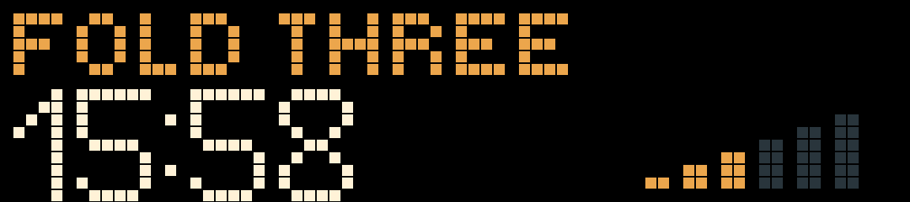
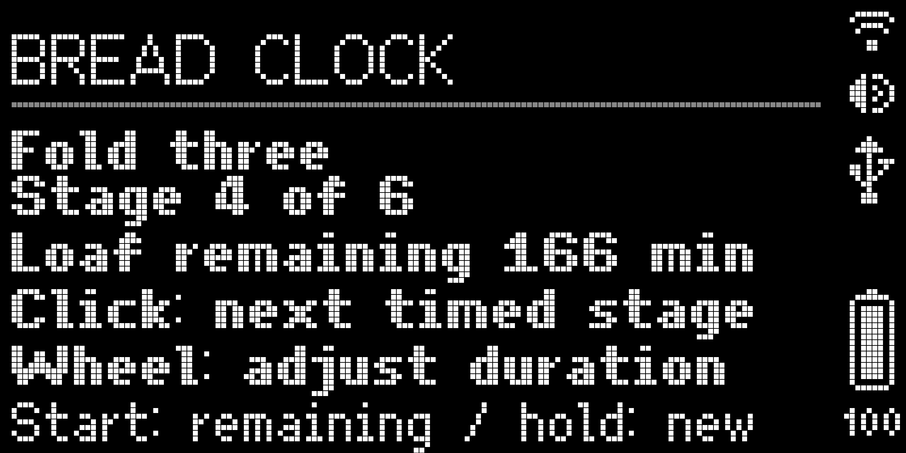
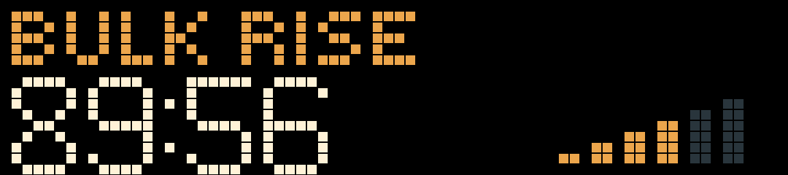

# Bread Clock

Guide a loaf from mixing through folds to proofing using the times you actually start each step.

A late fold changes when the dough will be ready. Bread Clock starts each new timer when you actually touch the dough, so a delay at the bench carries through to proofing without rewriting a schedule.

## Screen transitions

Follow the dough from one step to the next, then adjust the time left.



<details>

<summary>Watch the rear display</summary>



</details>

## Start a loaf and work through the folds

1. At the mixing bowl, click the wheel on **Start loaf**. The first 30 minutes cover mixing and autolyse.
2. When you finish the first stage, click once to start **Fold one**. Click again on each subsequent handoff. An expired timer stays on its stage until you confirm it.
3. After **Fold three**, click to start the 90-minute bulk rise. The recording picks up at this handoff.


## Give the dough more time

1. If the bulk rise needs another five minutes, turn the wheel up one notch. Turn it down to take five minutes off. The change applies to the active deadline.
2. When the dough is ready to shape, click to start **Final proof**.
3. Press **Start** to see the minutes remaining for the whole loaf. Press it again to return to the stage timer.



## Read the timing

The six default stages are 30, 30, 30, 30, 90 and 60 minutes. That gives a four-and-a-half-hour loaf if you confirm each step on time. If you wait ten minutes before confirming a fold, the following stage still gets its full duration. The whole-loaf view adds the active countdown to the durations of the stages still ahead.

After the final proof, click to show **Bake now**. Hold **Start** when you want to clear the schedule and begin a fresh loaf.

## Run in the emulator

Open BUSY Bar Emulator. From this repository, run:

```sh
~/.busy-emulator/bin/busy-emulator dev --once
```

Press **Back** to exit.

The GIFs are excerpts from the emulator recording. Each LED occupies a 16 × 16 cell with a black border. The end frames pause for reading.

[Full recording](media/controls.mp4) · [Rear display](screenshots/back-1.png) · [Firmware test](EMULATOR-QA.md) · [MIT license](LICENSE)
